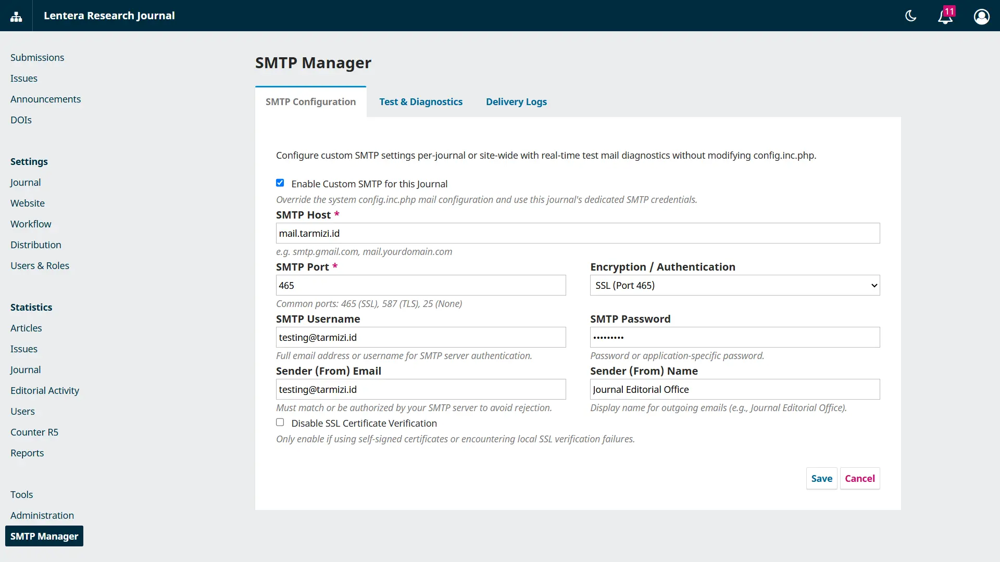

# OJS SMTP Manager Plugin

[](https://www.php.net/)
[](https://www.smarty.net/)
[](https://developer.mozilla.org/en-US/docs/Web/JavaScript)
[](https://developer.mozilla.org/en-US/docs/Web/CSS)
[](https://developer.mozilla.org/en-US/docs/Web/HTML)

A flexible SMTP configuration, per-journal credential isolation, and real-time diagnostic testing plugin for Open Journal Systems (OJS). Empowers journal administrators and managers to configure dedicated outgoing email servers through the user interface and immediately troubleshoot delivery issues without touching server configuration files (`config.inc.php`).



## Background Problem

In standard OJS deployments, outgoing email settings are restricted to the global `config.inc.php` file on the web server:
- Changing email host or credentials requires direct server or cPanel file access.
- All hosted journals are forced to share a single global SMTP account, leading to SPF/DKIM alignment mismatches, sender identity conflicts, and spam flagging.
- No built-in tool exists to test email connectivity or view real-time handshake errors, leaving administrators blind when mail fails to deliver.

**SMTP Manager** resolves these challenges by introducing per-journal SMTP configuration and live test email diagnostics natively inside the OJS management backend.

## Key Features

- **Per-Journal SMTP Isolation**:
  - Configure distinct SMTP hosts, ports, and credentials for individual journals.
  - Automatically overrides server-level mail transport runtime when enabled.
- **Full Credential & Transport Management**:
  - Supports standard SMTP ports (`465`, `587`, `25`).
  - Encryption options: `TLS` / STARTTLS, `SSL`, or plain unencrypted.
  - Custom sender (*From*) email address and display name per journal.
- **One-Click Live Diagnostic Tester**:
  - Send a live test email directly from the settings interface.
  - Real-time client-server socket handshake capture (`>> EHLO`, `<< 250`, `>> AUTH`, etc.) for instant troubleshooting.
- **Outgoing Delivery Logging**:
  - Dedicated delivery log history table (`smtp_delivery_logs`) tracking timestamp, recipient, subject, SMTP host, and status (`sent` / `failed`).
  - Automatic fallback to default server mailer (`config.inc.php`) when custom SMTP is disabled, with delivery logging maintained.
  - One-click log refresh and history clearing.
- **Dedicated Backend Menu Page & Modal**:
  - Access via direct sidebar menu item (**SMTP Manager**) under Administration/Tools or via plugin modal settings.
- **SSL / Certificate Verification Bypass**:
  - Optional toggle to bypass SSL verification for local development, staging environments, or private mail relays with self-signed certificates.
- **Bilingual Interface**:
  - Fully translated into English (`en`) and Indonesian (`id`).

## Installation

1. Clone or extract the plugin into your OJS plugins directory:
   ```bash
   git clone https://github.com/dimartarmizi/ojs-smtp-manager.git plugins/generic/smtpManager
   ```
   *Or extract the release archive into `plugins/generic/smtpManager`.*

2. Ensure correct directory and file permissions:
   ```bash
   chmod -R 755 plugins/generic/smtpManager
   ```

3. Log in as Journal Manager or Site Administrator.

4. Navigate to **Settings > Website > Plugins > Installed Plugins**.

5. Under **Generic Plugins**, locate and enable **SMTP Manager**.

6. Access the plugin via the **SMTP Manager** link in the left sidebar menu (or click the arrow next to the plugin name and select **Settings**). Configure your SMTP credentials, run test diagnostics, and monitor delivery logs.

## Authors & Maintainers

- **Author**: Dimar Tarmizi
- **Organization**: [Open Journal Center](https://github.com/openjournalcenter)
- **Repository**: [https://github.com/dimartarmizi/ojs-smtp-manager](https://github.com/dimartarmizi/ojs-smtp-manager)

## License

This plugin is licensed under the [GNU General Public License v3.0](LICENSE).

